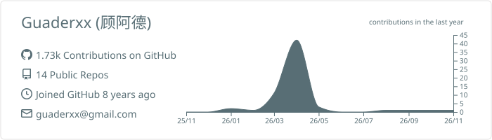
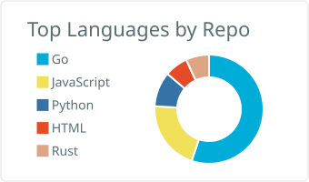
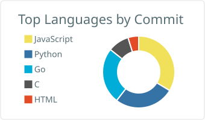
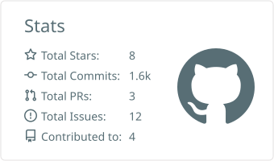
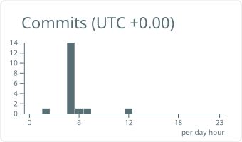
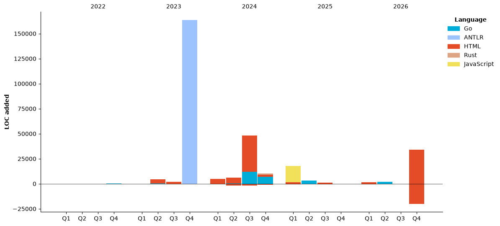

### Hi there 👋

<picture>
  <source media="(prefers-color-scheme: dark)" srcset="https://raw.githubusercontent.com/Guaderxx/Guaderxx/output/github-snake-dark.svg">
  <source media="(prefers-color-scheme: light)" srcset="https://raw.githubusercontent.com/Guaderxx/Guaderxx/output/github-snake.svg">
  
</picture>

<div align="center">









</div>

<!--START_SECTION:waka-->


**🐱 My GitHub Data** 

> 📦 418.8 kB Used in GitHub's Storage 
 > 
> 🏆 63 Contributions in the Year 2026
 > 
> 💼 Opted to Hire
 > 
> 📜 44 Public Repositories 
 > 
> 🔑 20 Private Repositories 
 > 
📊 **This Week I Spent My Time On** 

```text
🕑︎ Time Zone: Asia/Shanghai

💬 Programming Languages: 
Markdown                 1 hr 41 mins        ███████████████████████░░   91.10 % 
Go                       5 mins              █░░░░░░░░░░░░░░░░░░░░░░░░   05.21 % 
JavaScript               2 mins              █░░░░░░░░░░░░░░░░░░░░░░░░   02.57 % 
SQL                      1 min               ░░░░░░░░░░░░░░░░░░░░░░░░░   01.05 % 
HTML                     0 secs              ░░░░░░░░░░░░░░░░░░░░░░░░░   00.08 % 

🔥 Editors: 
Zed                      1 hr 51 mins        █████████████████████████   100.00 % 

💻 Operating System: 
Windows                  1 hr 51 mins        █████████████████████████   100.00 % 
```

🤖 **AI Coding This Week** 

```text
No AI Coding Activity Tracked This Week
```

**I Mostly Code in Go** 

```text
Go                       17 repos            ████████████░░░░░░░░░░░░░   50.00 % 
JavaScript               6 repos             ████░░░░░░░░░░░░░░░░░░░░░   17.65 % 
HTML                     3 repos             ██░░░░░░░░░░░░░░░░░░░░░░░   08.82 % 
Rust                     2 repos             █░░░░░░░░░░░░░░░░░░░░░░░░   05.88 % 
ANTLR                    1 repo              █░░░░░░░░░░░░░░░░░░░░░░░░   02.94 % 
```


**Timeline**




 Last Updated on 25/11/2026 02:41:24 UTC
<!--END_SECTION:waka-->
